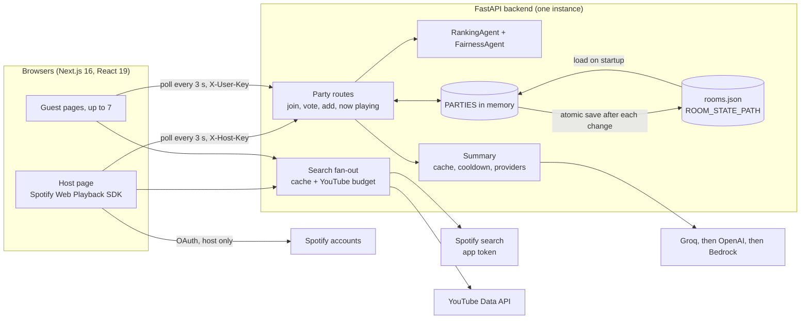

# AI Playlist Mixer

A fair party queue across Spotify and YouTube. One host opens a party, up to 7 guests join from their phones with a 6-character code, and everyone adds, votes and watches the same queue. The queue is ranked for the whole room, then reordered so one genre cannot take over, and an AI DJ writes a short summary of the room's taste.

<!-- DMV Music Alliance: add the link to the public evidence of use here. -->

**Backend:** [Railway](https://ai-playlist-mixer-production.up.railway.app) · **Security:** [SECURITY.md](SECURITY.md)

---

## Architecture



No architecture image existed in the repository before this README; the diagram above is drawn in Mermaid so GitHub renders it from text.

| Layer | Technology |
|---|---|
| Frontend | Next.js 16, React 19 (Vercel) |
| Backend | FastAPI, Python 3.12 (Railway) |
| Music | Spotify Web Playback SDK, Spotify Web API, YouTube Data API v3 |
| ML | content-based affinity, KMeans guest clusters (scikit-learn), genre rerank |
| AI summary | Groq (`openai/gpt-oss-120b` by default), optional OpenAI and Amazon Bedrock |

---

## How fairness works

1. Rank for the room (`RankingAgent.rank`). Every guest's candidate tracks are pooled. Each track gets `0.55 x average affinity + 0.30 x coverage + 0.10 x popularity + vote boost`, where affinity per guest is 50% genre overlap, 25% energy closeness, 20% danceability closeness and 5% popularity, coverage is the share of guests with affinity of at least 0.55, and the vote boost is 0.04 per net vote, capped at 5 votes either way.
2. Spread genres (`FairnessAgent.rerank`). Walk the ranked list and, at each turn, take the best track that shares no genre with the two tracks before it; if none qualifies, take the best one anyway.
3. Votes. Each joined guest holds one up or down choice per track. A vote moves only that track's score, then the queue is sorted and the same genre rerank runs again.

### Benchmark

`backend/benchmarks/fairness.py` simulates parties with fixed seeds and five guest mixes and compares three strategies. Full report: [backend/benchmarks/results/fairness.md](backend/benchmarks/results/fairness.md) (JSON alongside). Generated with:

```bash
cd backend && python -m benchmarks.fairness --seeds 0-29 --plays 20 --repeats 5
```

All mixes, mean of per-mix means, first 20 plays:

| strategy | plays min/max | plays Gini | guests never served | worst guest wait | exposure min/max | distinct genres | longest same-genre run | latency ms |
|---|---:|---:|---:|---:|---:|---:|---:|---:|
| popularity | 0.32 | 0.222 | 0.34 | 11.6 | 0.25 | 12.5 | 4.6 | 0.004 |
| round_robin | 0.61 | 0.085 | 0.00 | 5.6 | 0.44 | 12.0 | 3.4 | 0.043 |
| current | 0.44 | 0.147 | 0.17 | 7.1 | 0.43 | 11.2 | 1.4 | 0.427 |
| current_no_rerank | 0.37 | 0.193 | 0.58 | 12.5 | 0.27 | 10.5 | 6.4 | 0.190 |
| current_after_vote | 0.44 | 0.149 | 0.17 | 6.9 | 0.42 | 11.3 | 1.5 | 0.686 |
| after_vote_sort_only | 0.37 | 0.193 | 0.58 | 12.2 | 0.29 | 10.5 | 6.3 | 0.454 |

`current` is what Generate Queue does. A guest counts as served by a play when their affinity for it is at least 0.55. Latency was measured on one laptop and is only useful for comparing rows.

What the numbers say:

- The genre rerank does its job: the longest same-genre run drops from 6.4 to 1.4, and guests with no matching track in the first 20 plays drop from 0.58 to 0.17 on average.
- Votes used to undo it. The old vote path only re-sorted by score (`after_vote_sort_only`), which brought back runs of 6.3. Votes now rerank too (`current_after_vote`).
- The rerank spreads genres, not guests. In the balanced 7-genre mix, round-robin serves guests far more evenly (plays min/max 0.67 against 0.05 for `current`). Round-robin is the stronger choice when per-guest turns matter more than taste blending.
- `FairnessAgent.rerank` is O(n^2). With every track in one genre it measured 0.043 ms at 25 tracks and 11.3 ms at 400.

---

## Platform limits

- Since March 9, 2026, Spotify apps in development mode need Premium and allow up to 5 authorized users ([Spotify](https://developer.spotify.com/blog/2026-02-06-update-on-developer-access-and-platform-security)).
- Only the host signs in to Spotify, so that cap applies to hosts, not guests. In-browser playback uses the Web Playback SDK, which needs Premium.
- Guests never sign in. Search uses an app-level client-credentials token, so guests can search the Spotify catalog without an account.
- YouTube results come from the YouTube Data API, and the host plays them in an embedded player. With no YouTube key, or once the per-minute YouTube budget is used, search still answers from Spotify and the local catalog.
- How playback behaves for a host on a free Spotify account has not been tested.

---

## Reliability

- Persistence. Room state (guests, queue, votes, keys, now playing) is saved to a JSON file after every change, at `ROOM_STATE_PATH` (default `data/rooms.json`). Each write goes to a temp file in the same folder, is fsynced, and is swapped in with `os.replace`, so a crash mid-write leaves the previous file whole. One write runs at a time, and every state change runs under one lock.
- Restart recovery. On startup the app loads that file, so a restart or redeploy keeps every live party with its queue intact. A test starts a brand-new Python process on a saved file and gets the same queue back. Spotify tokens are not saved: after a restart the host taps Connect Spotify again.
- Expiry. Parties with no poll and no change for `ROOM_IDLE_TTL_SECONDS` (default 6 hours) are dropped.
- Single instance. State lives in one process and one file. Two workers or two replicas would each keep their own parties and overwrite each other's file, so run one replica with one worker (`Procfile` uses `-w 1`).
- Why polling stays. Each device asks for the room every 3 seconds. With at most 8 devices per party and one instance, that is about 2.7 requests per second per party, a vote reaches every device within 3 seconds, and nothing has to manage socket connections, reconnects or sticky routing. Polls only replace state that changed, so the YouTube player does not reload (checked: three polls, zero iframe reloads).

---

## LLM summary

- Providers, tried in order: Groq (`GROQ_API_KEY`, `GROQ_MODEL`), then OpenAI (`OPENAI_API_KEY`), then Amazon Bedrock through the Converse API (`BEDROCK_MODEL_ID` plus AWS credentials). Set `LLM_PROVIDER` to use only one. Bedrock is off unless configured; `boto3` is imported only then (`pip install -r requirements-bedrock.txt`). The Bedrock path is tested with a stub, not against live AWS. With no keys the app uses a template summary.
- Cache. The summary is keyed on a hash of the exact prompt: guests and their tastes, the top 8 tracks in order with scores, and now playing. If nothing the model would see has changed, there is no call.
- Cost bound. At most one call per party per 30 seconds (the existing cooldown), zero for an unchanged room, one at a time per party. A test drives 200 Generate clicks over 10 simulated minutes and stays within 21 calls.
- Injection tests. Guest names and track titles are untrusted. They are flattened to one line, length-capped, and placed in a fenced data block that the system prompt marks as data. The reply is stripped to short plain text: no HTML, scripts, links or markdown. `backend/evals/party_summary.yaml` (llm-eval-kit format) holds hostile rooms such as names that say to ignore the rules, script tags, a track that tries to close the data block, and a request to print the system prompt. `tests/test_summary_evals.py` runs it locally with stub models. How a live model handles those rooms has not been measured yet.
- Eval gate in CI. `backend/evals/render_kit_suites.py` turns those rooms into the real prompts and writes two suites to `backend/evals/kit/`; CI fails if they are out of date with the prompt code. `.github/workflows/evals.yml` runs them through the shared [llm-eval-kit](https://github.com/SushantTusharJoshi/llm-eval-kit) action. On every pull request the mock suite checks the prompt itself (one fenced data block, nothing from guests after it, no line a guest name started) against `backend/evals/kit/baseline.mock.json`; removing a case or breaking the fence fails the job. On push to `main` and manual runs, the Groq suite sends the same prompts to `openai/gpt-oss-120b`, an LLM judge scores the replies, and the injection cases are critical. The judge is the same model as the one under test, so the report carries a warning. The Groq job has not run yet; it skips itself without the `GROQ_API_KEY` secret.

---

## Run locally

```bash
# Backend
cd backend
python -m venv venv && source venv/bin/activate
pip install -r requirements.txt
cp .env.example .env   # fill in what you have; everything is optional
uvicorn app.main:app --reload --port 8000
python -m pytest -q    # tests

# Frontend
cd frontend
npm ci
NEXT_PUBLIC_API_BASE=http://localhost:8000 npm run dev
```

Open [http://localhost:3000](http://localhost:3000). Without Spotify, YouTube or LLM keys the app still runs: search uses the local catalog and the summary uses a template.

For Spotify sign-in, add this redirect URI in the Spotify app dashboard:

```
http://localhost:8000/auth/spotify/callback
```

---

## Deploy

- Backend on Railway, frontend on Vercel. Set `NEXT_PUBLIC_API_BASE` on Vercel to the Railway URL, and `FRONTEND_URL` on Railway to the Vercel URL (CORS and the OAuth redirect use it).
- Persistence: add a Railway volume to the backend service (for example mounted at `/data`) and set `ROOM_STATE_PATH=/data/rooms.json`. Without a volume the file sits on the container disk and is lost on redeploy. Keep one replica.
- Backend and frontend should deploy together when the API changes, as the host and guest keys did.

---

## Code map and cards

Interview-critical functions carry a header (`What it does`, `Catch it`, `Card`) and one `STEP`, `LOOP`, `DECISION` or `RETURN` comment per flowchart box. Each card in `docs/cards/` has the question, how to catch it, a flowchart, what changed, interviewer questions and twists.

| Box | File | The move | Card |
|---|---|---|---|
| Genre rerank | `backend/app/agents/fairness_agent.py` `rerank` | best track that shares no genre with the last two | [rerank](docs/cards/rerank.md) |
| One vote per voter | `backend/app/agents/voting_agent.py` `vote` | store each voter's choice, not click counts | [vote](docs/cards/vote.md) |
| Group ranking score | `backend/app/agents/ranking_agent.py` `rank` | average affinity + coverage + popularity + clamped votes | [ranking-score](docs/cards/ranking-score.md) |
| Summary cache | `backend/app/main.py` `_refresh_summary` | key on a hash of the exact prompt, then cooldown | [summary-cache](docs/cards/summary-cache.md) |
| Atomic save | `backend/app/persistence.py` `RoomStore.save` | temp file, fsync, `os.replace`, one writer | [persistence-save](docs/cards/persistence-save.md) |
| Restore on startup | `backend/app/persistence.py` `RoomStore.load` | validate each party alone; set aside a bad file | [persistence-load](docs/cards/persistence-load.md) |
| Search fan-out | `backend/app/services/search.py` `search_all` | cache, then Spotify, then YouTube within a budget | [search-fanout](docs/cards/search-fanout.md) |
| Party join and code | `backend/app/main.py` `join` | the code finds the room; a secret key acts in it | [party-join](docs/cards/party-join.md) |
| OAuth callback | `backend/app/main.py` `spotify_callback` | single-use server state decides the party | [oauth-callback](docs/cards/oauth-callback.md) |
| Polling sync | `frontend/app/party/[code]/page.tsx` `poll` | replace only what changed, every 3 s | [polling-sync](docs/cards/polling-sync.md) |

---

## Known gaps

| Gap | Why | Possible fix |
|---|---|---|
| YouTube audio stops when the player is closed | the embed needs a visible iframe | YouTube IFrame API with `playVideo()` |
| An open YouTube player keeps the old video when the track changes | `ytVideoId` is set only by Watch Video (from reading the code, not tested) | follow `now_playing.youtube_id` while the player is open |
| Spotify playback may stop after the access token expires | the host page hands the SDK the first token and never calls `/refresh-token` (from reading the code, not tested) | fetch a fresh token in `getOAuthToken` |
| Host controls live on one device | the host key is in that browser's storage | show the key as a QR code to move it |
| Single host | if the host leaves, nobody controls playback | promote a guest |

---

## Privacy

Party and host pages are private links: they send `noindex` in both a meta tag and an `X-Robots-Tag` header, so search engines do not list them.
