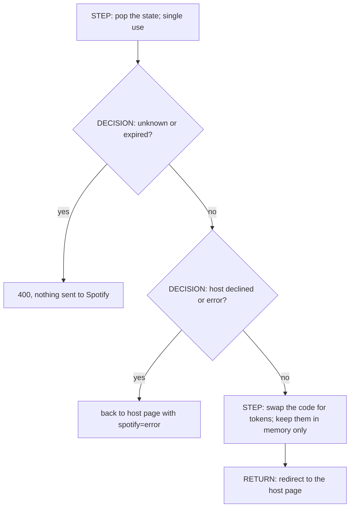

# Card: OAuth callback

Code: `spotify_callback` and `spotify_login_url` in `backend/app/main.py`

## The question

"What is the OAuth state parameter for, and what breaks if you skip checking it?"

## How to catch it

`state` ties the callback to a sign-in this server started for this user. Generate it on the server, store it, accept it once. Anything the callback needs (here, the party) comes from the stored state, never from the URL.

## Flowchart

## Slips (what changed)

- Before: `state` was `PARTYCODE:random` and the callback trusted the party code inside it without checking it was issued. Anyone could bind their own Spotify login to someone else's party, or trick a victim into binding theirs to a party the attacker could read.
- Now: the login URL comes from `POST /party/{code}/spotify/login-url`, which needs the host key; `state` is a random nonce with a 10-minute expiry; replays are rejected (tested).
- Tokens are never returned by `GET /party/{code}` and never written to the room file.

## Interviewer questions

- "Is this an open redirect?" No: the redirect is built from the configured `FRONTEND_URL`.
- "Why not PKCE?" This is a confidential client with a server-side secret; PKCE would add defence in depth and is a twist below.
- "Who can read the access token?" Only a request with the host key (`/party/{code}/spotify-token`).

## Twists

- Add PKCE.
- Drop scopes the app does not use (`user-top-read`, `user-read-recently-played`, `playlist-modify-public`) after testing playback.
- Encrypt tokens at rest if they are ever persisted.
