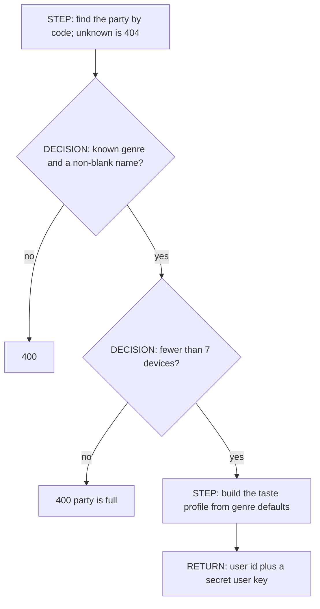

# Card: party code and join

Code: `join` and `_code` in `backend/app/main.py`

## The question

"The party code is in a public link. What can someone do with only the code?"

## How to catch it

Separate "can find the room" from "can act in the room". A short shareable code is fine for finding; actions need a secret handed to the device that earned it (created the party, or joined it).

## Flowchart

## Slips (what changed)

- Join now returns a `user_key` (`secrets.token_urlsafe(16)`); votes and additions need it.
- Names are capped at 40 characters and flattened to one line.
- The 7-device check runs under `STATE_LOCK`; a test runs 20 parallel joins and gets exactly 7.

## Interviewer questions

- "How guessable is a code?" 36^6, about 2.2 billion, drawn with `secrets.choice`. Guessing one live party at 1,000 requests a second takes weeks, and a guessed code only gives guest powers now.
- "What does the code alone allow?" Reading the room (poll, leaderboard) and joining. Host actions need the host key; votes and additions need a user key.
- "Can a guest see others' keys?" No: poll and `GET /party/{code}` leave out every key and token.

## Twists

- Longer or word-based codes (for example three short words) for easier sharing with more entropy.
- Host approval for joins.
- Rate-limit join attempts per code.
