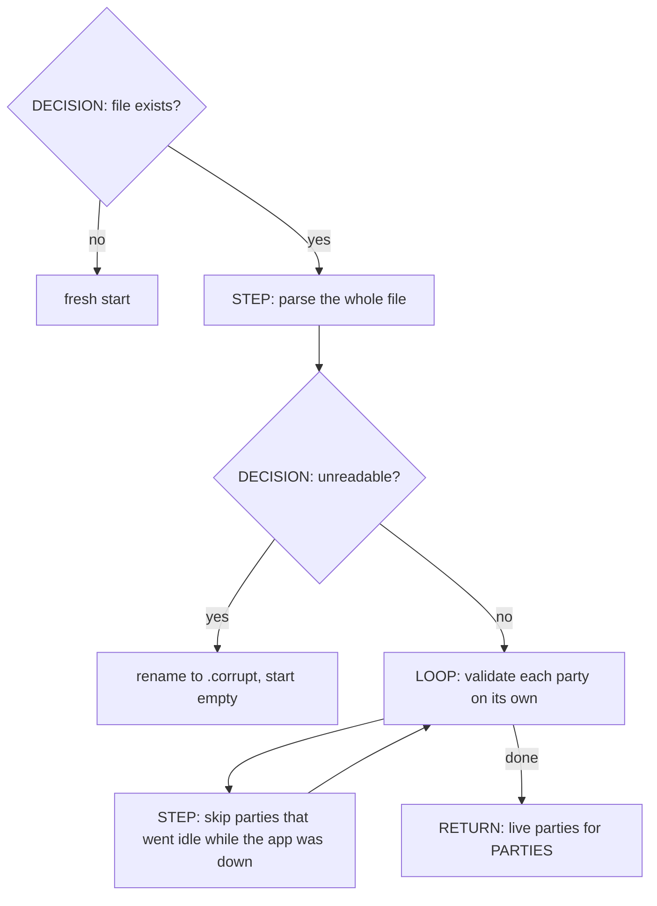

# Card: restore on startup

Code: `RoomStore.load` in `backend/app/persistence.py`, called from `lifespan` in `backend/app/main.py`

## The question

"How do you restore state after a restart, and what if the file is bad?"

## How to catch it

Treat the saved file as untrusted input: parse it, validate each record on its own, and never let one bad record or a corrupt file stop the app from starting.

## Flowchart

## Slips (what changed)

- New in this build.

## Interviewer questions

- "How did you test restart recovery?" One app instance builds a party, generates a queue, votes, adds a track and sets now playing; a brand-new Python process pointed at the same file returns the same queue (tracks, order, scores, votes), members and now playing.
- "Do keys still work after a restart?" Yes: host and guest keys are saved, and a test votes with a restored guest key.
- "Why rename a corrupt file instead of deleting it?" So the data can still be inspected or recovered by hand.

## Twists

- Schema versioning: `version` is stored; add a migration step when the model changes.
- Load lazily per party on first request instead of all at startup.
