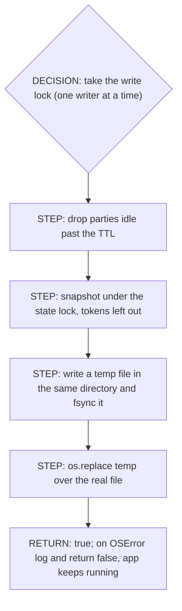

# Card: atomic save

Code: `RoomStore.save` in `backend/app/persistence.py`

## The question

"What happens if the server dies halfway through writing the file?"

## How to catch it

Never write over the only good copy. Write the new version next to it, flush it to disk, then swap it in with one rename. On POSIX, `os.replace` within one directory is atomic: a reader sees the whole old file or the whole new one.

## Flowchart

## Slips (what changed)

- New in this build. Before, every restart or redeploy wiped every party.
- `Procfile` went from 2 workers to 1, since state lives in one process.

## Interviewer questions

- "Why the same directory?" A rename across file systems is a copy, not atomic. Railway's volume is one file system.
- "Why hold the write lock across the snapshot?" Otherwise save A could snapshot, save B snapshot later and write first, then A overwrite B with older data.
- "Why not save tokens?" A file on disk is a second place to leak them; the host reconnects Spotify after a restart instead.
- "How do you know it works?" Tests make `os.replace` and `fsync` fail mid-save and check the old file is intact with no temp files left, and run 16 parallel saves that never overlap.

## Twists

- Debounce: mark dirty and save at most once a second.
- Write-ahead log of changes instead of whole snapshots.
- Move to SQLite (still one file, real transactions) when parties grow.
