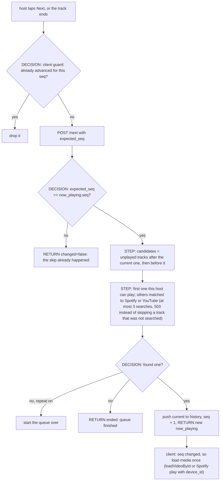

# Card: player

Code: `frontend/app/components/Player.tsx` (one player for host and guests), pure rules in `frontend/lib/player-state.ts`; server side `backend/app/playback.py` and the `/play`, `/next`, `/prev`, `/playback`, `/refresh-token` routes in `backend/app/main.py`

## The question

"Polls every 3 s, a track-end event and a Next tap all touch playback. Why does nothing stutter or double skip?"

## How to catch it

The server's `now_playing` is the one source of truth, and it carries a `seq` that goes up by one on every track change. The client loads media only when `seq` changes; a poll with an older `seq`, or the same `seq` and an older `updated_at`, is ignored. Every skip sends the `seq` it was looking at (`expected_seq`), so the second of two racing skips finds the room already moved on and changes nothing.

## Flowchart

## Slips (what changed)

Root causes found on `main` at 52dd34f, all reproduced in a local browser run except the Spotify ones (read from the code):

- YouTube tracks never played from the queue: `playAt` only posted now playing and said "user clicks Watch" (host page lines 93-98). No player was created, and a Spotify track that was playing kept playing.
- An open YouTube player kept the old video: the iframe followed `ytVideoId`, which only the Watch Video button set (lines 42-49, 235). Next changed the card, not the video.
- Next and Previous did nothing on most tracks: they stepped the index by one (lines 114-115) and `playAt` returned silently when that track had no Spotify uri (line 102). Generated catalog tracks have neither a uri nor a video, so the whole generated queue was unplayable. Up next and previous were read from a ref during render (lines 130-131), so they lagged.
- Pause was a no-op for YouTube and was undone by the next poll for Spotify: `togglePlay` only touched the Spotify SDK and set local state that the server never heard about (line 113); the poll then put `is_playing: true` back (lines 57-61). The bar also hid itself when paused (line 225), so there was no way to resume.
- Spotify playback could stop after an hour: `getOAuthToken` always handed the SDK the first token (line 79) and nothing called `/refresh-token`. The Web API reply was not checked (line 104), so a 401 or 403 was silent while the card said playing.
- Shuffle only reordered the local copy, which the next poll replaced (lines 55, 117).
- The search Next button called add-track and queue-next at once (line 161); add-track usually won, so queue-next saw a duplicate and the track sat at the end.
- The no-key YouTube fallback id `yt-search-...` was treated as a video id.
- Catalog tracks share `Track` objects with every party, so matching one to a source must copy it (caught by a test).
- After the rebuild (production party CDZ174): with no Spotify login, Spotify search results were skipped and the queue "finished" at once. `needs_resolving` only matched tracks with no uri at all, so a track with a Spotify uri was neither playable nor matched. Now any track this host cannot play is matched (YouTube when Spotify is not connected); a track is skipped only when its search found nothing, and a search that could not run returns 503 without skipping. Previous matches too. The search badge showed only YouTube for `spotify+youtube` results because it tested `src === 'spotify'`.

Checked locally after the fix (muted, YouTube and local catalog, no external accounts): play from a queue row creates one iframe; three polls left it untouched (0 `load` events); Next and Previous switch the video inside the same iframe; a 19 s video ended and advanced exactly once; an unavailable video showed "The owner does not allow this video to play outside YouTube" and skipped once; Pause on the host reached the guest card within a poll; a guest's Watch here followed the host's Next in its own single iframe. The Spotify path was checked against a mocked SDK and Web API only: token refresh 5 minutes before expiry, a 401 followed by refresh and one retry, three duplicate end events advancing once, and Pause.

## Interviewer questions

- "Why a sequence number and not the track id?" Previous to the same track, repeat with one track, and restart from 0 all keep the id but must reload the media.
- "Why does the server pick the next track?" It holds history, votes and Play next; two host tabs or a race between end and tap cannot disagree, and guests see the same Up next.
- "What if Spotify fails mid-party?" The error shows on the card; the token is refreshed on schedule, when the SDK asks, and after any 401. A revoked refresh token returns 502 and the card asks the host to connect again.
- "Why not auto-skip Spotify errors?" A 403 (no Premium) would fail every track; skipping through the queue would hide the real problem. Only per-video YouTube errors skip.

## Twists

- Crossfade: preload the next YouTube video in a second hidden player.
- Show "playing on another device" when the SDK reports a null state.
- Let a second device hold the host key (QR code) and hand playback over.
