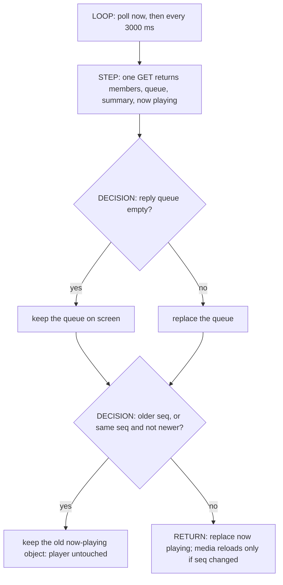

# Card: polling sync

Code: `poll` in `frontend/app/party/[code]/page.tsx` (the host page has the same pattern), now playing merged by `mergeNowPlaying` in `frontend/lib/player-state.ts`; server side `GET /party/{code}/poll` in `backend/app/main.py`

## The question

"Why polling instead of WebSockets, and how do you stop a poll from restarting the video?"

## How to catch it

With a handful of devices and a single server instance, a 3-second GET is simple, stateless, and survives proxies, sleep and network changes. The catch is re-rendering: only replace state that actually changed, or every poll will reset players.

## Flowchart

## Slips (what changed)

- The old rule (same track id and play state keeps the object) let a poll that left before a pause or a Next undo it on screen. Now playing carries `seq` (up on every track change) and `updated_at` (pause, resume, seek), and the merge keeps the newer one. See [player](player.md).
- Checked in the player rebuild: three polls with the host's YouTube player open left the one iframe in place with 0 `load` events, and Next switched the video inside that same iframe.
- Checked earlier (PM-F7): with the YouTube player open on a guest page, three polls ran and the iframe stayed the same element, with 0 `load` events and 0 `src` changes. The fix was already on `main` (the iframe `src` depends only on `ytVideoId`, which polls never set).
- The server marks the party active on each poll (idle expiry), without writing the file.

## Interviewer questions

- "What does it cost?" Up to 8 devices (7 guests and the host) x 1 request per 3 s = about 2.7 requests per second per party, each returning the whole queue (capped at 200 tracks).
- "Why not WebSockets?" They add connection state per device, reconnection logic, and sticky routing; with one instance and polling at 3 s, a vote reaches every device within 3 s, which is enough for a party.
- "Race between a click and a poll?" The click updates local state right away; the next poll brings the server's view, which already includes the click.

## Twists

- ETag or a version number so an unchanged room returns 304 with no body.
- Server-sent events for now playing only.
- Back off to 10 s when the tab is hidden.
