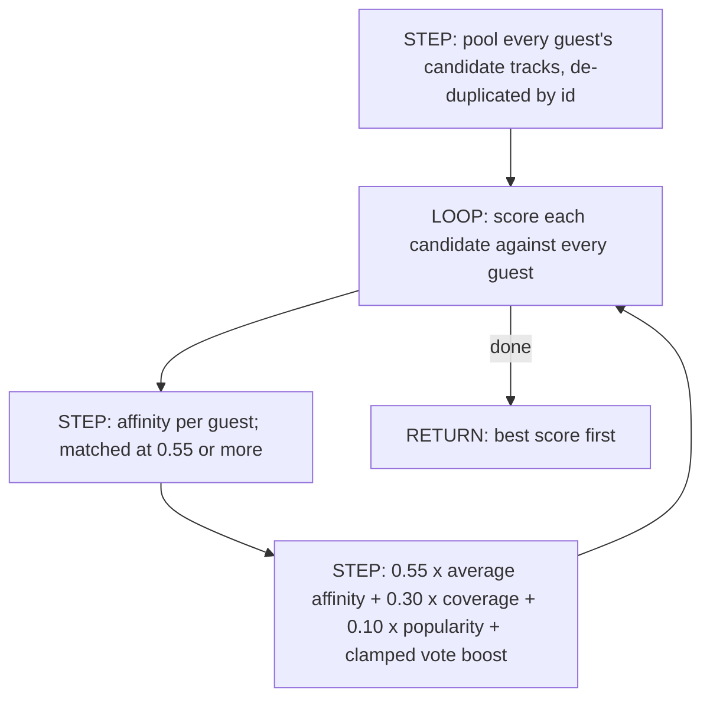

# Card: group ranking score

Code: `RankingAgent.rank` in `backend/app/agents/ranking_agent.py`; affinity in `backend/app/ml/features.py`

## The question

"How do you rank songs for a group instead of one listener?"

## How to catch it

For a group, score each item against every member and combine: average liking, how many members it reaches, and a small prior (popularity). Keep feedback (votes) as a bounded nudge so it cannot swamp the taste signal.

## Flowchart

Affinity per guest: 50% genre overlap (Jaccard), 25% energy closeness, 20% danceability closeness, 5% popularity.

## Slips (what changed)

- The vote clamp now comes from one helper, `vote_boost`, shared by ranking and the vote endpoint, so the two cannot drift apart.

## Interviewer questions

- "Why average affinity and not max?" Average favors tracks most of the room likes. The benchmark shows the cost: in a 7-genre party the least-served guest gets far fewer plays than under round-robin.
- "Why clamp votes?" So five friends cannot outvote taste entirely: the boost stops at 5 votes (0.2).
- "What is the complexity?" O(tracks x guests); with 7 guests and about 80 candidates it is under a millisecond in the benchmark.

## Twists

- Replace the weights with a learned ranker (LightGBM LambdaMART) trained on votes and skips.
- Least-misery aggregation: rank by the minimum affinity across guests.
- Contextual bandit that learns the weights during the party.
