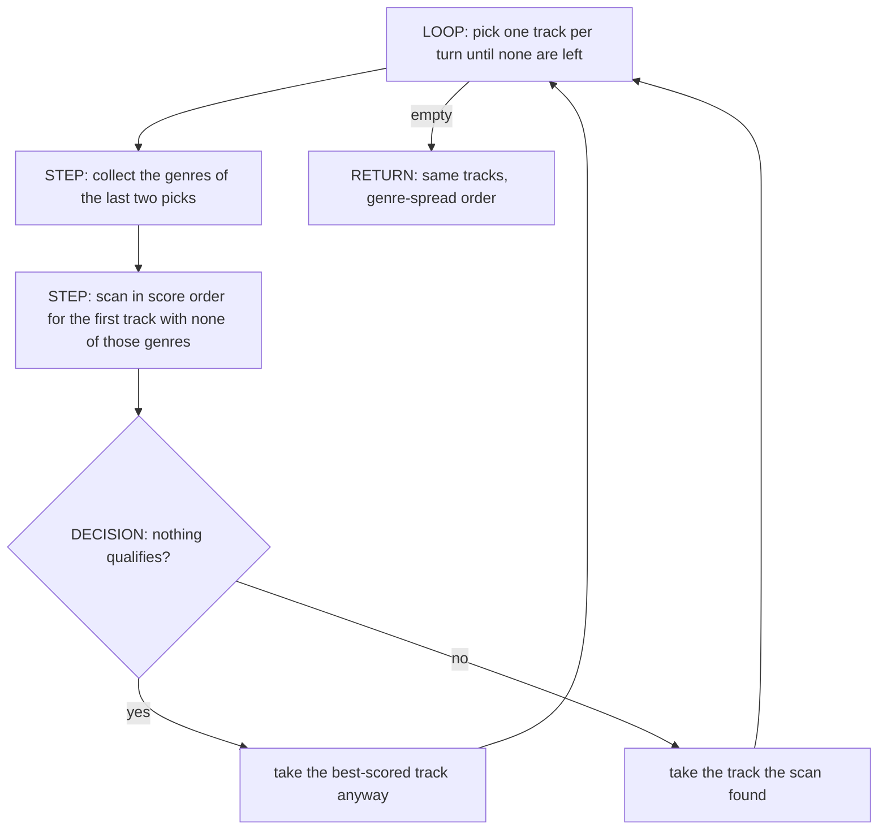

# Card: genre rerank

Code: `FairnessAgent.rerank` in `backend/app/agents/fairness_agent.py`

## The question

"Your ranking puts five pop songs in a row. How do you spread genres without losing the scores?"

## How to catch it

Spot it when a list is already sorted by score and the complaint is about runs of similar items next to each other. Do not re-score; walk the sorted list and, at each turn, take the best item that does not clash with the last few picks.

## Flowchart

## Slips (what changed)

- The vote endpoint used to re-sort by score after each vote, which threw this order away. The benchmark measured it: after one vote the longest same-genre run went from 1.4 back to 6.3. Votes now call `reorder_after_vote`, which sorts and then runs this rerank.
- The algorithm itself is unchanged.

## Interviewer questions

- "What is the complexity?" O(n^2): up to n turns, each scanning what is left, plus `list.remove`. The benchmark's one-genre case shows it: 0.043 ms at 25 tracks, 11.3 ms at 400.
- "Is this fair to guests?" It spreads genres, not guests. In the balanced 7-genre mix the benchmark shows round-robin serves guests far more evenly (plays min/max 0.67 vs 0.05).
- "What if every track is pop?" The fallback takes `remaining[0]`, so it degrades to plain score order instead of failing.

## Twists

- Heap-based rerank: keep one max-heap per genre and pop from the best heap whose genre is not in the window. About O(n log g) for g genres.
- Per-guest deficit: track how many plays each guest has had and boost the most under-served guest's best track (a round-robin that still respects scores).
- Make the window size a setting and benchmark 1, 2 and 3.
