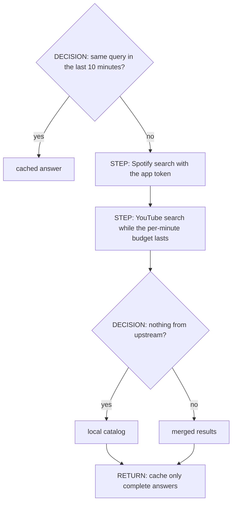

# Card: search fan-out

Code: `search_all` in `backend/app/services/search.py`

## The question

"Every keystroke can hit two paid APIs. How do you bound the cost?"

## How to catch it

Fan-out plus no auth plus a quota means you need a cache in front and a budget on the expensive leg. Keep a cheap fallback so users still get answers when the budget runs out.

## Flowchart

## Slips (what changed)

- Before: no cache, no budget, and `limit` unbounded. A YouTube search costs 100 of a 10,000-unit daily quota, so about 100 calls could use up the day for everyone.
- Now: query capped at 100 characters, `limit` at 1..20, a 10-minute cache, and `YOUTUBE_CALLS_PER_MINUTE` (default 30).
- Errors are logged by type only; the YouTube error used to print the URL with the API key.

## Interviewer questions

- "Why not cache failures?" An outage would then be served from cache for 10 minutes after it ended.
- "Why a global budget, not per IP?" Behind Railway's proxy the client IP needs a trusted forwarded header; that was not verified, and a wrong guess puts all guests in one bucket.
- "Spotify and YouTube in sequence?" Yes, today. They could run with `asyncio.gather`.

## Twists

- Run both upstream calls in parallel with a timeout each.
- Per-party budget keyed on the party code.
- Prefix cache: reuse "beyon" results for "beyonc".
