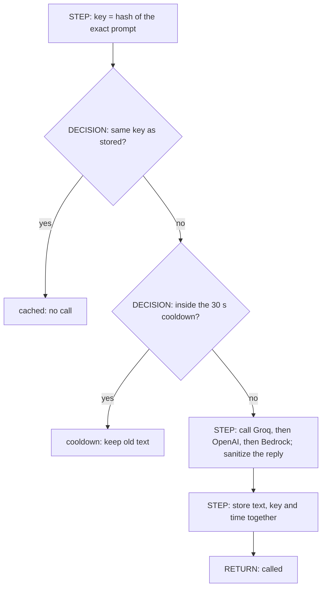

# Card: summary cache and cost bound

Code: `_refresh_summary` in `backend/app/main.py`; prompt, sanitizer and providers in `backend/app/agents/llm_agent.py` and `backend/app/llm/providers.py`

## The question

"How do you keep LLM cost bounded when the host keeps clicking Generate?"

## How to catch it

Cache on the inputs, not on a proxy. The safest key is a hash of the exact prompt: if the model would see the same text, there is nothing new to say. Add a time-based cooldown as a second, independent cap.

## Flowchart

## Slips (what changed)

- Before: only the 30-second cooldown, so an unchanged room still paid for a call every 30 seconds. Now an unchanged room makes zero calls (tested).
- A per-party in-flight guard stops two parallel clicks from both calling.
- The LLM call now runs in a worker thread; before, the blocking SDK call held up every poll.
- Guest names are fenced in a data block and the reply is stripped to plain text (see `backend/evals/party_summary.yaml`).

## Interviewer questions

- "What is in the key?" Guests with their genre and energy, the top 8 tracks in order with scores, and now playing. A vote that does not change the top 8 makes no call (tested).
- "What is the worst case?" One call per party per 30 s: 120 calls per party-hour. The cost test drives 200 clicks over 10 simulated minutes and stays within ceil(600 / 30) + 1.
- "What if Groq is down?" The next provider is tried, then a template summary.

## Twists

- Semantic cache: embed the prompt and reuse a summary when the room is close enough.
- Stream the summary to the page.
- Run the eval suite in CI against a live model on a schedule.
