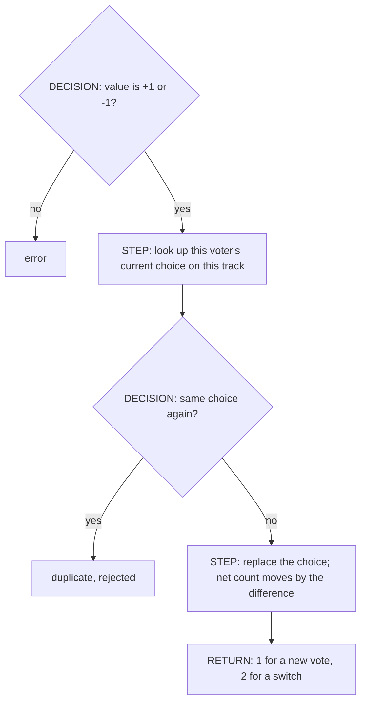

# Card: one vote per voter

Code: `VotingAgent.vote` in `backend/app/agents/voting_agent.py`, called by `POST /party/{code}/vote` in `backend/app/main.py`

## The question

"How do you stop one guest from voting a track to the top?"

## How to catch it

Any counter that users can bump needs an identity per bump. Store each voter's current choice, not a running total of clicks, and derive the total from the choices.

## Flowchart

## Slips (what changed)

- Before: `voted_by` was optional and the frontend never sent it, so one device could post any number of votes. Now the voter comes from a secret key (`X-User-Key` from `/join`, or the host key).
- Before: the endpoint recomputed the boost for every track using the voted track's value, so 60 downvotes lifted the last track to first place. Now only the voted track's score changes.
- Votes now live on the party, so they are saved and restored with it.

## Interviewer questions

- "Can a guest still cheat?" They can rejoin for a new key, but the party holds at most 7 devices, and the boost is clamped at 5 votes.
- "What about switching from up to down?" Allowed: the stored choice flips and the count moves by 2.
- "What stops votes on made-up track ids filling memory?" The endpoint rejects tracks that are not in the queue.

## Twists

- Time-decayed votes, so early votes fade during a long party.
- Weight votes by how under-served the voter is.
- Thompson sampling over up and down votes to explore new tracks.
